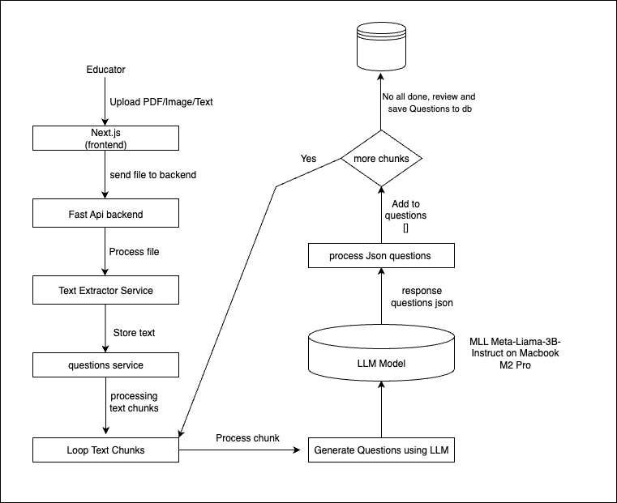
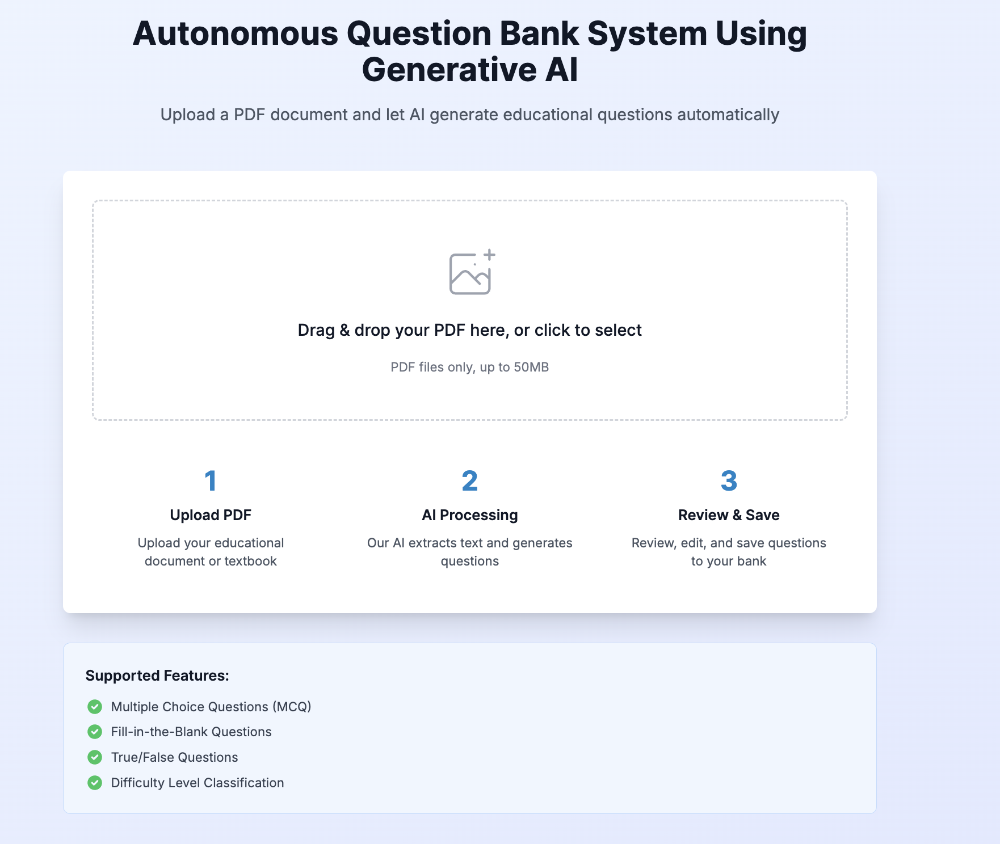
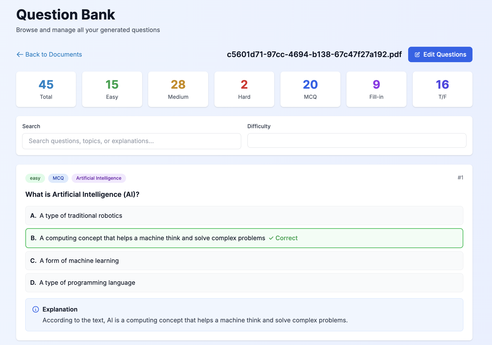

<div align="center">

# LLM-Powered Question Bank (POC)

### Turn course material into a reviewed question bank with large language models

*A proof of concept: upload a PDF, let an LLM — Llama 3 locally via MLX or Ollama, or OpenAI GPT — generate multiple-choice, fill-in-the-blank and true/false questions, review and edit them, and save them to MongoDB.*

[](https://github.com/MRafiqAsim/llm-question-bank/actions/workflows/ci.yml)
[](pyproject.toml)
[](frontend/package.json)
[](LICENSE)
[](https://github.com/astral-sh/uv)

</div>

---

## Why

Keeping assessments in sync with course content is slow manual work: every new chapter or revised topic means rewriting questions, and banks drift out of date or repeat themselves. This POC automates the first draft — an LLM generates questions straight from the learning material — while keeping **instructors in the loop** to review, edit and approve every question before it enters the bank.

## How it works



1. **Upload** — the instructor uploads a PDF in the Next.js frontend.
2. **Extract** — the FastAPI backend extracts the text with `pymupdf4llm` and stores it.
3. **Chunk** — the text is split into overlapping chunks (2,000 characters, 200 overlap by default).
4. **Generate** — each chunk is sent to the LLM with a structured prompt; the model returns questions as JSON (type, difficulty, topic, options, answer and an explanation).
5. **Review** — the instructor reviews the questions and edits them where needed.
6. **Save** — approved questions are stored in MongoDB, ready to build tests.

### LLM providers

| Provider | Model (default) | Runs | Best for |
|---|---|---|---|
| **MLX** | `mlx-community/Meta-Llama-3-8B-Instruct-4bit` | Locally on Apple Silicon (GPU) | Fastest local option, no data leaves the machine |
| **Ollama** | `llama3` | Locally or in Docker (CPU/GPU) | Any platform, fully offline |
| **OpenAI** | `gpt-4o-mini` | Cloud API | Fastest processing, minimal setup |

Switch with one setting — `LLM_PROVIDER=mlx|ollama|openai` in `.env`.

## Screenshots

| Upload | Generated question bank |
|---|---|
|  |  |

## Tech stack

| Layer | Technology |
|---|---|
| Frontend | Next.js 15, React, TypeScript, Tailwind CSS |
| Backend | Python, FastAPI, Pydantic |
| Text extraction | pymupdf4llm |
| LLM | Llama 3 (MLX, Ollama), OpenAI GPT |
| Database | MongoDB (Motor async driver) |
| Packaging | uv, Docker, Docker Compose |

## Quick start

Requires [uv](https://docs.astral.sh/uv/), Node.js 18+ and Docker (for MongoDB).

```bash
git clone https://github.com/MRafiqAsim/llm-question-bank.git
cd llm-question-bank
cp .env.example .env
(cd frontend && npm ci)
```

Then pick a provider:

**A. Apple Silicon with MLX (local, recommended on a Mac)**

```bash
./start.sh          # choose option 1 — installs MLX with `uv sync --extra mlx`
```

The first run downloads the ~4 GB Llama 3 model.

**B. Docker with Ollama (any platform, fully offline)**

```bash
./docker-start-with-ollama.sh
```

Starts MongoDB, Ollama (pulls Llama 3, ~4.7 GB on first run), the backend and the frontend.

**C. OpenAI API (any platform)**

Set `LLM_PROVIDER=openai`, `MODEL_NAME=gpt-4o-mini` and `OPENAI_API_KEY` in `.env`, then run `./start.sh` and choose option 3.

Open **http://localhost:3000** (API docs at http://localhost:8000/docs). Stop everything with `./stop.sh`; `./clean.sh` also removes the Docker containers and volumes.

## Using it

1. Upload a PDF on the home page.
2. The pipeline extracts the text and generates questions chunk by chunk, with progress shown.
3. Review the questions one by one and edit any that need it.
4. Save the approved ones to the question bank and browse them by type and difficulty.

### API

| Endpoint | Purpose |
|---|---|
| `POST /api/upload/` | Upload a PDF |
| `POST /api/process/full-pipeline/{file_id}` | Extract text and generate questions |
| `GET /api/process/questions/{file_id}` | Get the generated questions |
| `POST /api/questions/save` | Save approved questions to MongoDB |
| `GET /health` | Service and database status |

## Configuration

All settings live in `.env` (see [`.env.example`](.env.example)):

| Setting | Default | Meaning |
|---|---|---|
| `LLM_PROVIDER` | `mlx` | `mlx`, `ollama` or `openai` |
| `MODEL_NAME` | Llama 3 8B Instruct (4-bit) | Model for the chosen provider |
| `MAX_CHUNK_SIZE` / `CHUNK_OVERLAP` | `2000` / `200` | Text chunking for generation |
| `DEFAULT_QUESTIONS_PER_CHUNK` | `5` | Questions generated per chunk |
| `MLX_TEMPERATURE` / `MLX_MAX_TOKENS` | `0.7` / `2048` | Generation settings for MLX |
| `MONGODB_URL` | `mongodb://localhost:27017` | Database connection |

## Performance (Apple M2 Pro, MLX)

- Text extraction: ~5–10 s for a 100-page PDF
- Question generation: ~30–60 s per chunk (5 questions)
- Model loading: ~10 s after the first download

With the OpenAI API, processing takes roughly 20 s per page.

## Project structure

```
backend/
├── api/            # FastAPI app and routes (upload, process, questions)
├── config/         # Settings from environment variables
├── models/         # MongoDB connection and Pydantic schemas
└── services/       # Upload, text extraction and question workflows
ml/
├── inference/      # LLM service: MLX, Ollama and OpenAI providers
└── prompts/        # Question-generation prompt templates
frontend/           # Next.js app: upload, processing, review, question bank
tests/              # pytest suite
```

## POC scope and next steps

This proof of concept covers PDF input, three question types, three LLM providers and a human review step. Planned next:

- **More input formats** — scanned PDFs and images (OCR) and plain text
- **Version-aware updates** — track which questions belong to which edition of the material and regenerate them when content changes
- **Quality feedback loop** — use reviewer edits to refine prompts and spot coverage gaps
- **Integrations** — export to learning-management systems such as Moodle, Canvas and Blackboard

## Responsible use

Generated questions are drafts: they are always reviewed by an instructor before use, and users are told the content is AI-generated. Used for practice and preparing material, a system like this falls in the minimal-risk category of the EU AI Act; using it to grade students would make it high-risk, requiring risk assessment, data governance, human oversight and transparency measures.

## Development

```bash
uv sync
uv run pytest
uv run ruff check . && uv run ruff format --check .
(cd frontend && npm run build)
```

## Support

Did this save you a few hours of writing quiz questions? Help fuel the next release with a [coffee (€5)](https://paypal.me/mrafiq89/5EUR) ☕ — or leave a ⭐ so others can find it too.

## License

[Apache License 2.0](LICENSE).
